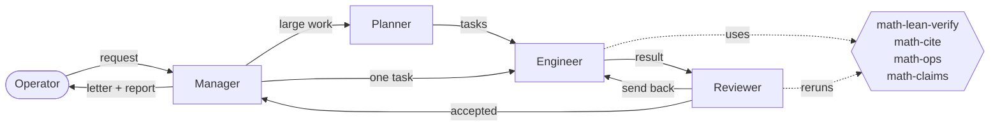

<p align="center">
  <picture>
    <source media="(prefers-color-scheme: dark)" srcset="assets/argus-logo-dark.svg">
    <source media="(prefers-color-scheme: light)" srcset="assets/argus-logo-light.svg">
    
  </picture>
</p>

<h1 align="center">Argus Math</h1>

<p align="center">
  <strong>An autonomous team that reads, checks and explains mathematics, and writes it up so a mathematician can follow.</strong><br>
  <a href="README.zh-CN.md">中文</a> ·
  <a href="docs/MATH_SPEC.zh-CN.md">Spec</a> ·
  <a href="pack/math/SKILL.md">How the team works</a> ·
  <a href="https://github.com/Argus-AiTeam/argus-mathematics">Results</a>
</p>

<p align="center">
  
  
  
  
</p>

---

## What it does

- **Explains a paper.** For each paper, a reader's guide: the problem and the main theorem in plain
  terms, a roadmap, the core idea with a worked example, the hard passages with the skipped steps
  filled in. After reading it, the paper itself is easier.
- **Checks it.** The steps the main theorem stands on are rechecked: by hand, by exact computation,
  or in Lean. Errors and gaps are reported only with the sentence of the paper they concern.
- **Pushes it further.** Sharper constants, weaker hypotheses, optimality examples, each shown side
  by side with the original statement.

On OpenAI's collection of 721 manuscripts, this found improvements over the stated result in
134 of 373 families, and no mathematical error.
[See the results →](https://github.com/Argus-AiTeam/argus-mathematics/tree/main/openai-math)

## How it works



The **core** (Argus ts-core, in [`core/`](core/)) runs the four roles on a coding-agent CLI
(Copilot, Codex, Claude Code or Pi), passes letters between them and keeps the record. The **math
pack** ([`pack/math/`](pack/math/)) tells the team how to do mathematics and gives it four tools:

| Tool | What it gives |
|---|---|
| `math-lean-verify` | Compiles Lean against Mathlib; says plainly whether anything uses `sorry` and which axioms each theorem rests on |
| `math-cite` | Fetches the cited work (arXiv, DOI) so the cited proposition is read in the version cited |
| `math-ops` | About 1,800 typed exact operations from Jacobian: Smith forms, lattices, certified LP/SAT, homology… |
| `math-claims` | Reads the claims tables back out of reports, sums them up, and can recompile the Lean behind them |

## What it holds to

- **Written for a reader.** Idea first, then skeleton, then details; disclaimers only where they change something.
- **Every claim says whose it is.** "The paper is wrong" points to a sentence of the paper.
- **Only Lean makes something proved.** Everything else names its evidence: computation, literature or judgement.
- **One record.** The report holds the proof and what each step rests on; nothing keeps a second copy.
- **No findings on demand.** "No problem found in what was checked" is a result.

The full rules are in the [spec](docs/MATH_SPEC.zh-CN.md) (Chinese) and [`SKILL.md`](pack/math/SKILL.md).

## Quick start

```bash
git clone --recurse-submodules https://github.com/Argus-AiTeam/argus-counterexample-runtime.git argus-math
cd argus-math
ops/install                                   # builds the core, installs `argus`, adds the math pack
argus --backend copilot --model gpt-6.1-sol   # or install ops/argus-ts.service
```

Open the address it prints. To review one family of OpenAI's collection:

```bash
ops/openai-family/make-workspace 127 ~/workspaces --lang en
```

then open a project on that workspace and paste its `REQUEST.md`.

## Repository

| Path | |
|---|---|
| [`core/`](core/) | Argus ts-core, a submodule pinned to `lbx154/Argus` `feat/ts-core` |
| [`pack/math/`](pack/math/) | The math pack: `SKILL.md`, setup (Lean, Mathlib, Jacobian), tools, tests |
| [`ops/`](ops/) | `install`, the user service, workspace preparation for OpenAI families |
| [`docs/`](docs/) | The spec, the single authority; the migration plan from the Python runtime |

The retired Python runtime is kept on the branch
[`backup/python-runtime`](https://github.com/Argus-AiTeam/argus-counterexample-runtime/tree/backup/python-runtime).
