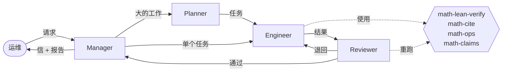

<p align="center">
  <picture>
    <source media="(prefers-color-scheme: dark)" srcset="assets/argus-logo-dark.svg">
    <source media="(prefers-color-scheme: light)" srcset="assets/argus-logo-light.svg">
    
  </picture>
</p>

<h1 align="center">Argus Math</h1>

<p align="center">
  <strong>一支自主工作的团队：读数学、核数学、讲清数学，写出数学家读得懂的东西。</strong><br>
  <a href="README.md">English</a> ·
  <a href="docs/MATH_SPEC.zh-CN.md">规格</a> ·
  <a href="pack/math/SKILL.md">团队怎么工作</a> ·
  <a href="https://github.com/Argus-AiTeam/argus-mathematics">成果</a>
</p>

<p align="center">
  
  
  
  
</p>

---

## 它做什么

- **讲清一篇论文。** 每篇论文一份导读：用平实的话讲问题和主定理，给出路线图，讲核心想法并配一个手算的例子，
  把最难读的几处讲透、补上原文跳过的步骤。读完导读再读原文，明显轻松。
- **核验它。** 主定理依靠的那几步，用手算、精确计算或 Lean 重新核过。指出错误和缺口时，一定指向原文里的那句话。
- **往前推一步。** 更好的常数、更弱的假设、最优性例子，每一条都和原结论并排写出。

在 OpenAI 的 721 篇论文上，它在 373 个家族中的 134 个里找到了对原结论的改进，没有发现数学错误。
[查看成果 →](https://github.com/Argus-AiTeam/argus-mathematics/tree/main/openai-math)

## 它怎么工作



**内核**（Argus ts-core，在 [`core/`](core/)）在编程 Agent 命令行（Copilot、Codex、Claude Code 或 Pi）上运行四个角色，
在角色之间传信、保存记录。**数学 pack**（[`pack/math/`](pack/math/)）告诉团队怎么做数学，并提供四个工具：

| 工具 | 作用 |
|---|---|
| `math-lean-verify` | 用 Mathlib 编译 Lean，直接说明有没有 `sorry`、每个定理依赖哪些公理 |
| `math-cite` | 取回被引文献（arXiv、DOI），在所引的那个版本里读到被引的命题 |
| `math-ops` | Jacobian 的约 1,800 种带类型的精确运算：Smith 标准形、格、带证书的 LP/SAT、同调…… |
| `math-claims` | 从报告里读出命题表并汇总，可重新编译"Lean 已证"背后的文件 |

## 它坚持什么

- **写给读者。** 先讲想法，再给骨架，最后是细节；免责声明只在影响读者判断的地方出现。
- **每条结论写明是谁的。** 说"原文有错"，必须指向原文里的一句话。
- **只有 Lean 才算已证。** 其余结论写明凭的是计算、文献还是判断。
- **只有一份记录。** 证明和每一步的依据写在报告里，别处不另存。
- **不为出成果而制造发现。** "在核过的范围内没有发现问题"本身就是结论。

完整规则见[规格](docs/MATH_SPEC.zh-CN.md)和 [`SKILL.md`](pack/math/SKILL.md)。

## 快速开始

```bash
git clone --recurse-submodules https://github.com/Argus-AiTeam/argus-counterexample-runtime.git argus-math
cd argus-math
ops/install                                   # 构建内核，安装 argus 命令，装入数学 pack
argus --backend copilot --model gpt-6.1-sol   # 或安装 ops/argus-ts.service 作为常驻服务
```

打开它打印出的地址。审 OpenAI 论文集的一个家族：

```bash
ops/openai-family/make-workspace 127 ~/workspaces --lang zh
```

然后在这个工作区上新建项目，贴入其中的 `REQUEST.md`。

## 仓库结构

| 路径 | |
|---|---|
| [`core/`](core/) | Argus ts-core，子模块，固定在 `lbx154/Argus` 的 `feat/ts-core` |
| [`pack/math/`](pack/math/) | 数学 pack：`SKILL.md`、setup（Lean、Mathlib、Jacobian）、工具、测试 |
| [`ops/`](ops/) | `install`、常驻服务、为 OpenAI 家族准备工作区 |
| [`docs/`](docs/) | 规格（唯一权威）；从 Python runtime 迁移的方案 |

退役的 Python runtime 保存在
[`backup/python-runtime`](https://github.com/Argus-AiTeam/argus-counterexample-runtime/tree/backup/python-runtime) 分支。
